# SAMVAD PERCEPTION ADVISORY — Data Model Specification

## 1. Domain Entities & ERD

```mermaid
erDiagram
    Lead {
        string id PK
        string fullName
        string corporateEmail
        string companyName
        string jobTitle
        string phoneNumber
        enum serviceInterest
        enum industry
        string estimatedBudgetRange
        text message
        enum status
        string sourceIp
        string userAgent
        datetime createdAt
        datetime updatedAt
    }

    Service {
        string id PK
        string slug UK
        string title
        string tagline
        enum serviceType UK
        text description
        json capabilities
        json deliverables
        boolean isFeatured
        int orderIndex
        datetime createdAt
        datetime updatedAt
    }

    Industry {
        string id PK
        string slug UK
        string title
        enum industryType UK
        text summary
        json strategicChallenges
        json advisorySolutions
        int orderIndex
        datetime createdAt
        datetime updatedAt
    }

    CaseStudy {
        string id PK
        string slug UK
        string title
        enum clientSector
        string anonymizedClientName
        text challenge
        text strategicIntervention
        json impactMetrics
        boolean isFeatured
        datetime publishedAt
        datetime createdAt
        datetime updatedAt
    }

    Insight {
        string id PK
        string slug UK
        string title
        string subtitle
        enum category
        string authorName
        string authorRole
        int readTimeMinutes
        text contentMarkdown
        enum status
        datetime publishedAt
        datetime createdAt
        datetime updatedAt
    }

    PressRelease {
        string id PK
        string slug UK
        string title
        text summary
        text body
        string mediaContactName
        string mediaContactEmail
        string pdfAttachmentUrl
        datetime publishedAt
        datetime createdAt
        datetime updatedAt
    }

    AdminUser {
        string id PK
        string email UK
        string name
        string passwordHash
        enum role
        boolean isActive
        datetime lastLoginAt
        datetime createdAt
        datetime updatedAt
    }

    AuditLog {
        string id PK
        string userId FK
        string action
        string entityType
        string entityId
        json metadata
        string ipAddress
        datetime timestamp
    }

    AdminUser ||--o{ AuditLog : records
```

---

## 2. Indexing & Query Optimization Strategy

1. **Leads**:
   - `@@index([status])`: Facilitates rapid CRM workflow filtering.
   - `@@index([serviceInterest])`: Directs leads to specialized practice leads.
   - `@@index([corporateEmail])`: Prevents duplicate inquiries and flags recurring institutional touches.
   - `@@index([createdAt])`: Enables time-series analysis and cohort reporting.
2. **Services & Industries**:
   - `@@index([orderIndex])`: Guarantees deterministic display order without sort penalties.
   - `@@index([isFeatured])`: Instantly resolves homepage spotlight services.
3. **Case Studies & Insights**:
   - `@@index([slug])`: Primary index for ultra-low latency routing (`O(1)` btree lookup).
   - `@@index([category], [status])`: Enables segmented publishing workflows (Draft vs. Published).
   - `@@index([publishedAt])`: Efficient chronological pagination.
4. **Audit Logs**:
   - `@@index([userId])`, `@@index([entityType, entityId])`, `@@index([timestamp])`: Essential for SOC2 / ISO 27001 regulatory compliance audits and immutable trail verification.
