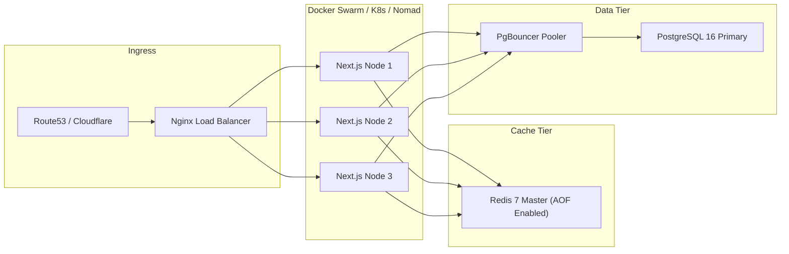

# SAMVAD PERCEPTION ADVISORY — Deployment & Horizontal Scalability

## 1. Concurrency Model: Supporting 1,000+ Concurrent Users

To achieve deterministic sub-100ms response times for 1,000+ concurrent sessions:

1. **Stateless Application Tier**:
   - Next.js application servers store zero session state in local memory.
   - User sessions, rate-limit buckets, and cached responses reside in Redis.
   - Any container can be killed, restarted, or auto-scaled without dropping client state.

2. **Database Connection Virtualization (PgBouncer)**:
   - PostgreSQL creates a heavy OS process per client connection. 1,000 direct connections can degrade database performance.
   - PgBouncer operates in `transaction` pooling mode, multiplexing thousands of incoming application connections onto a steady pool of ~50 physical PostgreSQL connections.

3. **Multi-Stage Docker Containerization**:
   - Minimal Alpine-based image (~150MB).
   - Non-root user execution (`nextjs:nodejs`).
   - Native Next.js standalone runner (`node apps/web/server.js`), stripping out unused dev dependencies and extraneous package files.

---

## 2. Infrastructure Topology

