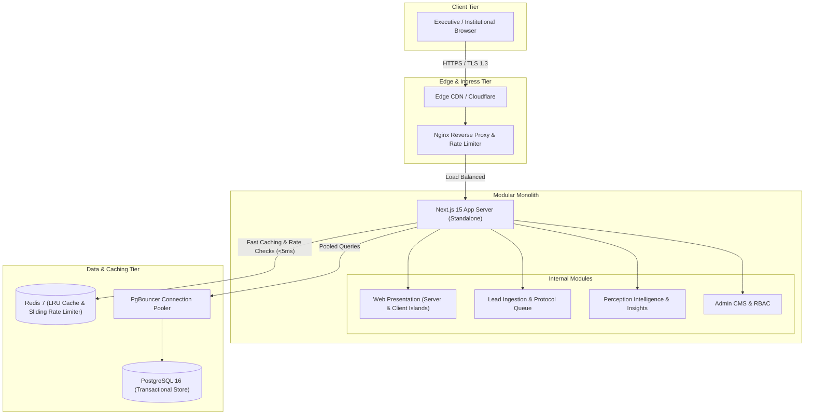

# SAMVAD PERCEPTION ADVISORY — Architecture Overview

## 1. Executive Summary

**SAMVAD PERCEPTION ADVISORY** is an institutional-grade digital platform engineered for a premier PR, strategic communications, reputation management, and advisory company.

The platform balances two core imperatives:

1. **Public Stature & Narrative Authority**: Presenting an ultra-premium, interactive experience (Three.js/R3F, GSAP, Framer Motion, Lenis smooth scrolling) to establish immediate trust with sovereign leadership, defense innovators, and Fortune 500 decision-makers.
2. **Enterprise Reliability & Confidentiality**: A modular monolith architecture engineered for 1,000+ concurrent users, sub-50ms cache hits via Redis, strict zero-leakage security posture, and a clean pathway toward future service extraction without premature microservice complexity.

---

## 2. High-Level Architecture Diagram (C4 Container View)

---

## 3. Modular Monolith Architecture

Rather than prematurely fracturing into separate microservices, SAMVAD adopts a **Modular Monolith** structure managed via a `pnpm` monorepo workspace:

| Module / Package      | Responsibility                                                     | Future Extraction Path                |
| :-------------------- | :----------------------------------------------------------------- | :------------------------------------ |
| `apps/web`            | Next.js 15 App Router presentation, SEO, server actions, 3D Canvas | Customer-facing edge deployment       |
| `packages/ui`         | shadcn/ui primitives, typography tokens, luxury styling            | Design system npm package             |
| `packages/database`   | Prisma schema, models, database client singleton, migrations       | Dedicated Database Service / Subgraph |
| `packages/redis`      | Redis client, cache-aside utilities, sliding window rate limiters  | Shared Caching Service                |
| `packages/validation` | Zod schemas for all inbound payloads, runtime env vars             | Shared API Contract Library           |
| `packages/types`      | TypeScript domain types, DTOs, API envelopes                       | Shared Types Library                  |
| `packages/config`     | Shared TypeScript, Tailwind, and ESLint presets                    | Tooling package                       |

### Clean Boundaries

- Monolith modules communicate in-process using strongly-typed boundaries (`@samvad/*`).
- Domain logic is isolated from transport layers (e.g. lead validation exists in `@samvad/validation` independent of Next.js HTTP request contexts).
- When traffic or organisational scaling demands it, the CMS, Lead Ingestion, or Perception Intelligence ingestion pipeline can be extracted into discrete autonomous microservices with minimal refactoring.

---

## 4. Concurrency & Scalability Strategy (1,000+ Concurrent Users)

To comfortably support 1,000+ concurrent users with deterministic latency:

1. **Server-First Rendering**: The vast majority of pages (insights, service overviews, industry verticals) are server-rendered and statically cached via ISR (Incremental Static Regeneration), bypassing server database queries on repeat visits.
2. **PgBouncer Connection Pooling**: Transaction-mode pooling limits PostgreSQL connection spikes to a managed pool of ~50 physical connections while serving thousands of application requests without memory thrashing.
3. **Redis Sliding-Window Rate Limiting**: Inbound lead transmissions and API endpoints are protected at the Redis layer using atomic pipeline operations (`INCR` + `EXPIRE`), absorbing burst requests in under 2ms.
4. **Horizontal Replica Scaling**: Next.js is packaged in `output: "standalone"` mode inside Docker. Nginx load-balances stateless Next.js replicas with least-connection round-robin scheduling.
