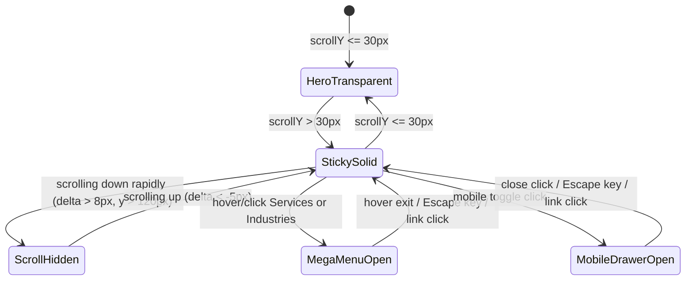

# SAMVAD Perception Advisory - Global Navigation System

## 1. Architectural Overview & Philosophy

The **SAMVAD Global Navigation System** is engineered to deliver an uncompromising, high-end editorial and consulting experience for **SAMVAD PERCEPTION ADVISORY PRIVATE LIMITED**.

Designed for institutional leaders, sovereign entities, and Fortune 500 executives, the navigation combines:
- **Transparent-to-Solid Sticky Morphing**: Starts transparent over dark atmospheric hero sections, transitioning smoothly into a frosted obsidian glass navbar with a warm gold top reflection upon scrolling.
- **Scroll-Aware Intelligent Docking**: Smoothly translates out of the viewport on rapid downward scrolling to prioritize editorial readability, and immediately glides back into view on upward scroll movements.
- **Interactive Multi-Column Mega Menus**: Rich, content-dense flyout panels for **Services** and **Industries**, featuring practice descriptions, category badges, and highlighted case dossiers.
- **Magnetic CTA Interaction**: High-affinity "Let's Talk" button equipped with physics-driven magnetic cursor pull.
- **Full Mobile Navigation Drawer**: Touch-optimized slide-over sheet with accordion disclosures, body scroll lock, and keyboard trap.

---

## 2. Navigation Hierarchy & Information Architecture

```
[SAMVAD Brand Lockup]
  ├── About           -> /#about
  ├── Services [Mega] -> /#services
  │     ├── Perception Intelligence & Sentiment Topology (Predictive)
  │     ├── Crisis Architecture & Litigation Defense (24/7 War Room)
  │     ├── Strategic Communications & M&A Genesis (Capital Markets)
  │     ├── Public Affairs & Sovereign Statecraft (Statecraft)
  │     ├── Executive Positioning & Leadership (Confidential)
  │     ├── Digital Sovereignty & Algorithm Defense (DeepTech)
  │     └── Spotlight: Case Record #8104 ($1.8B Deal Preservation)
  ├── Industries [Mega] -> /#industries
  │     ├── [01] Defense & Strategic Aerospace (Sovereign)
  │     ├── [02] Banking & Global FinTech (Tier-1 Capital)
  │     ├── [03] Critical Infrastructure & Energy (National Arteries)
  │     ├── [04] Healthcare & Life Sciences (R&D)
  │     ├── [05] Enterprise DeepTech & AI (Frontier AI)
  │     ├── [06] Family Offices & Sovereign Funds (Discreet)
  │     └── Spotlight: Sovereign & Enterprise Corridors ($40B+ Advised)
  ├── Work            -> /#case-studies
  ├── Insights        -> /#intelligence
  ├── Newsroom        -> /#newsroom
  └── [Asset System]  -> /asset-system
[Magnetic CTA: "Let's Talk"] -> /#contact
```

---

## 3. Component Architecture

### 3.1 Framework-Agnostic Design (`@samvad/ui`)

The navigation components are implemented in `@samvad/ui` without tight coupling to Next.js internals, accepting an optional polymorphic `linkComponent`:

```tsx
import { GlobalNavbar } from "@samvad/ui";
import Link from "next/link";

export function Header() {
  return (
    <GlobalNavbar
      ctaText="Let's Talk"
      ctaHref="/#contact"
      enableScrollAwareHide={true}
      linkComponent={Link} // Enables Next.js prefetching & client transitions
    />
  );
}
```

### 3.2 Motion & Interaction State Machine



---

## 4. Accessibility & Standards Compliance

- **ARIA Semantics**: `role="navigation"`, `aria-label="Global Navigation"`, `aria-haspopup="true"`, `aria-expanded` attributes on all dropdown triggers.
- **Keyboard Navigation**:
  - `Tab` navigates seamlessly through interactive elements in natural DOM order.
  - `Enter` / `Space` toggles mega menu dropdowns and drawer accordions.
  - `Escape` immediately dismisses active mega menus or the mobile drawer and restores focus.
- **Touch Ergonomics**: All interactive targets on mobile maintain a minimum touch area of $44 \times 44\text{px}$.
- **Focus Rings**: High-contrast gold focus rings (`focus:ring-1 focus:ring-gold-500/50`) without breaking dark mode aesthetics.
