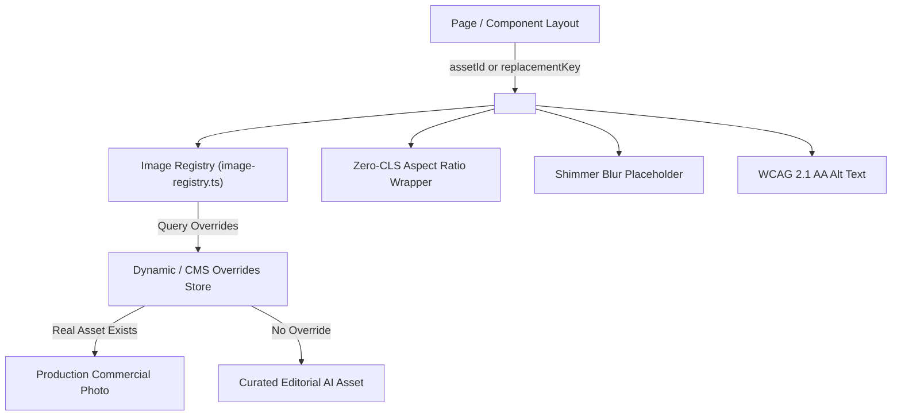

# SAMVAD Perception Advisory - AI Image Asset System Architecture

## 1. Executive Summary & Philosophy

SAMVAD PERCEPTION ADVISORY operates at the highest tier of strategic public relations, crisis communications, and reputation management. In high-stakes corporate advisory, visual credibility is paramount:

* **No Stock-Photo Clichés**: Traditional stock photography—synthetic corporate handshakes, smiling models facing the camera, sterile white office suites—destroys executive credibility.
* **Authentic Indian & Global Context**: Visuals must reflect real centers of economic power: Mumbai's Bandra-Kurla Complex (BKC), New Delhi's diplomatic corridors, Bengaluru's technological innovation lofts, and premier institutional infrastructure.
* **Atmospheric, Architectural & Material Focus**: Imagery prioritizes tactile reality—matte limestone, heavy debossed linen dossiers, fluted timber, optical crystal prisms, and ambient raking sunlight.
* **Strict Personnel Policy**: AI-generated individuals must **never** be presented as real SAMVAD partners, team members, or client executives. Any human presence is strictly atmospheric, silhouetted, or focused on hands over briefing documents.
* **Decoupled Replacement Architecture**: Every image in the system is mapped to an immutable **Replacement Key** (e.g. `SAMVAD_CORP_COMM_PODIUM_01`). When commercial photography is commissioned, real assets swap into production with **zero layout shift (CLS: 0.00)**.

---

## 2. The 14 Core Visual Categories & Catalog Manifest

| # | Category | Replacement Slot Key | Primary Asset Path | Aspect Ratio & Resolution | Target Subject & Art Direction |
|---|---|---|---|---|---|
| **01** | **Corporate Communication** | `SAMVAD_CORP_COMM_PODIUM_01` | `/images/corporate-communication/press-podium.jpg` | 16:9 (1376×768) | Acoustic timber and dark glass press podium prepared for enterprise disclosure. |
| **02** | **Leadership** | `SAMVAD_LEADERSHIP_SILHOUETTE_01` | `/images/leadership/skyline-silhouette.jpg` | 16:9 (1376×768) | Contemplative leadership silhouette overlooking Mumbai BKC commercial skyline at dusk. |
| **03** | **Business Meetings** | `SAMVAD_MEETINGS_BRIEFING_TABLE_01` | `/images/business-meetings/briefing-table.jpg` | 16:9 (1376×768) | Documentary close-up of hands over debossed leather dossiers, fountain pen, and crystal glass on teak wood. |
| **04** | **Media Interaction** | `SAMVAD_MEDIA_BRIEFING_ROOM_01` | `/images/media-interaction/press-briefing-room.jpg` | 16:9 (1376×768) | Authentic press corps camera ranks on tripods facing an illuminated acoustic briefing stage. |
| **05** | **Technology** | `SAMVAD_TECH_DATACORE_01` | `/images/technology/datacenter-optical-core.jpg` | 16:9 (1376×768) | Symmetrical tier-4 enterprise data center and optical network exchange with amber telemetry reflections. |
| **06** | **Infrastructure** | `SAMVAD_INFRA_VIADUCT_01` | `/images/infrastructure/highspeed-viaduct.jpg` | 16:9 (1376×768) | Elevated concrete high-speed rail viaduct traversing morning mist at golden sunrise. |
| **07** | **Healthcare** | `SAMVAD_HEALTH_BIOTECH_01` | `/images/healthcare/biotech-cleanroom-microscopy.jpg` | 16:9 (1376×768) | High-precision laser microscopy and cleanroom clinical instrumentation in certified pharma R&D. |
| **08** | **Finance** | `SAMVAD_FINANCE_ATRIUM_01` | `/images/finance/financial-center-atrium.jpg` | 16:9 (1376×768) | Monumental architectural atrium of a premier banking institution with natural skylights and marble reflections. |
| **09** | **Startup Ecosystem** | `SAMVAD_STARTUP_LOFT_01` | `/images/startup-ecosystem/innovation-loft.jpg` | 16:9 (1376×768) | Founders collaboration in an industrial loft in Bengaluru, analyzing system architectures on whiteboard walls. |
| **10** | **Reputation & Crisis** | `SAMVAD_REPUTATION_WARROOM_01` | `/images/reputation/crisis-monitoring-center.jpg` | 16:9 (1376×768) | Communications crisis war room with real-time sentiment telemetry displays and calm leadership under pressure. |
| **11** | **Communication** | `SAMVAD_COMM_DIALOGUE_01` | `/images/communication/strategic-dialogue-prism.jpg` | 16:9 (1376×768) | Refracted illumination through optical crystal prism on obsidian slate, symbolizing clarity through dialogue. |
| **12** | **Abstract Perception** | `SAMVAD_ABSTRACT_PRISM_01` | `/images/abstract-perception/optical-prism-refraction.jpg` | 16:9 (1376×768) | Geometric light angles and optical caustics illustrating perception shaping and multifaceted truth. |
| **13** | **Editorial Backgrounds** | `SAMVAD_EDITORIAL_MONOLITH_01` | `/images/editorial-backgrounds/limestone-monolith-light.jpg` | 16:9 (1376×768) | Curved architectural limestone and fluted concrete with brushed brass inlay and generous negative space. |
| **14** | **Case Study Placeholders**| `SAMVAD_CASE_STUDY_BINDER_01` | `/images/case-study-placeholders/confidential-briefing-binder.jpg` | 16:9 (1376×768) | Heavy navy-charcoal textured linen dossier on fluted walnut and glass credenza beside warm reading lamp. |

---

## 3. Strict Negative Constraints & Compliance Rules

To maintain enterprise integrity, all image generation and procurement must adhere strictly to these constraints:

```
[STRICT NEGATIVE CONSTRAINTS]
- NO fake company logos, badges, or brand marks.
- NO fabricated media outlet names or synthetic broadcast news chyrons.
- NO fictitious client company names or mock balance sheets.
- NO fake awards, trophies, or artificial accreditation certificates.
- NO staged stock-photography handshakes or exaggerated corporate poses.
- NO generic smiling models looking directly into the camera lens.
- NO crypto/blockchain neon clichés, glowing coins, or synthetic cyber matrices.
- NO representation of AI-generated faces as named SAMVAD employees or client leadership.
```

### Personnel Representation Rule
> **Rule**: When human figures appear, they must function as atmospheric or contextual elements (e.g. silhouettes against city lights, hands resting beside an open brief, background camera operators in a press briefing). At no point should any AI-generated face be attributed as a real founder, partner, or client of SAMVAD.

---

## 4. Technical Architecture: Decoupled Replacement Registry

### 4.1 System Components



### 4.2 Using `<SamvadImage />` in Code

```tsx
import { SamvadImage } from "@samvad/ui";

// Referencing by asset ID
<SamvadImage
  assetId="corp-comm-press-podium"
  zoomOnHover
  caption="Corporate announcement briefing room."
  priority // For above-the-fold hero images
/>

// Or referencing directly by replacement key
<SamvadImage
  assetId="SAMVAD_LEADERSHIP_SILHOUETTE_01"
  showKeyBadge // In preview or editorial mode
/>
```

### 4.3 Swapping Placeholders for Real Photography

When client-approved commercial photography is delivered:
1. Place the new photography in `apps/web/public/images/[category]/[filename].jpg` (or CDN URL).
2. Register the override in `packages/ui/src/components/media/image-registry.ts` or via CMS config:
```ts
registerImageOverride("SAMVAD_CORP_COMM_PODIUM_01", {
  src: "https://cdn.samvadadvisory.com/assets/annual-conference-podium.webp",
  isAiGenerated: false,
  realPhotoSlot: {
    recommendedDimensions: "2560x1440",
    artDirection: "Actual SAMVAD press conference auditorium.",
    recommendedAspect: "16:9",
    status: "real-asset-ready",
  },
});
```
3. Because aspect ratios (`16:9`), responsive containers, and blur placeholders are maintained, the swap requires **zero refactoring of component templates** and causes **zero Cumulative Layout Shift**.

---

## 5. Photographic Direction Brief for Real Shoots

When commissioning commercial photographers for SAMVAD:

1. **Camera & Optics**: Medium format or full-frame 35mm / 50mm / 85mm prime lenses with natural shallow depth-of-field ($f/1.8$ to $f/2.8$).
2. **Lighting Philosophy**: 85% natural daylight or blue hour ambient twilight. Use warm, indirect tungsten lamps for interior shots ($2700\text{K} - 3200\text{K}$). Strictly avoid direct on-camera flash or flat studio umbrella lighting.
3. **Materials**: Highlight physical substrates—sandblasted travertine, fluted acoustic panels, full-grain leather, untreated bronze, and crystal optical prisms.
4. **Composition**: Clean, cinematic, asymmetrical framing with generous negative space for editorial typography.
